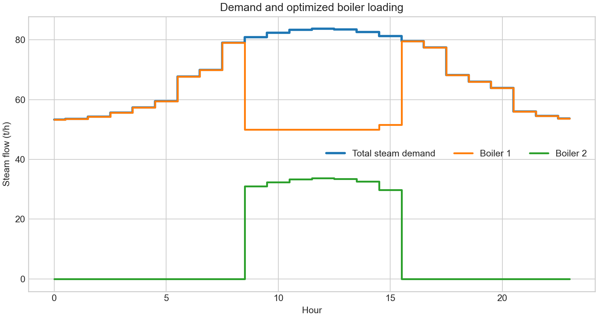

# OpenSteamOpt

[](https://github.com/abhijith-sivaprasadan/opensteamopt/actions/workflows/ci.yml)
[](LICENSE)
[](pyproject.toml)

OpenSteamOpt is an independent, open-source educational demonstrator for industrial
steam-and-power scheduling. It couples:

- a two-boiler, two-header dynamic plant in Modelica;
- a carbon-aware mixed-integer real-time optimisation (RTO) layer in Pyomo/HiGHS;
- an FMI 2.0 Co-Simulation path through OpenModelica and FMPy;
- a transparent Python shadow twin; and
- a light-theme Streamlit advisory workbench.

It is **not** an ABB product, an OPTIMAX clone, a commissioned plant model, or an
operational control system. All loads, prices and asset parameters are synthetic.



## What v0.1 demonstrates

```text
Natural-gas boiler ─┐
                    ├─ HP header ─┬─ HP process
Biofuel boiler ─────┘             ├─ back-pressure turbine ─┬─ MP header ─ process
                                  └─ pressure-reducing valve┘
                                               │
                                            generator ↔ grid
```

The hourly RTO chooses boiler commitment, startup, load, turbine flow, PRV flow and
grid import/export. It enforces minimum/maximum load, ordered piecewise fuel curves,
ramp limits and HP/MP/electrical balances. The objective includes fuel, carbon,
startup, turbine operating and electricity costs. HiGHS solves the MILP; a separate
accounting pass reconstructs the objective and checks all balances.

The dynamic layer applies accepted setpoints only to a local grey-box twin. A simple
proportional pressure trim represents lower-level stabilisation; it is explicitly not
MPC.

## Reproduced reference evidence

The committed [reference manifest](artifacts/reference/manifest.json) hashes every
result file. On the declared synthetic cases, the RTO produced:

| Scenario | Rule baseline | Optimised | Difference | Direct CO₂ |
|---|---:|---:|---:|---:|
| Base | €81,472.30 | €78,749.13 | 3.34% lower | 250.27 t |
| Power-price spike | €83,880.69 | €80,287.06 | 4.28% lower | 250.27 t |
| High carbon price | €102,928.01 | €93,719.71 | 8.95% lower | 102.85 t |

All optimised cases have zero unmet steam/power and a maximum independently computed
balance residual of `7.11e-15`. These are **software reference results**, not savings
or performance claims for a real plant. See [Verification](docs/VERIFICATION.md) and
[Model card](docs/MODEL_CARD.md).

The committed [FMU receipt](artifacts/fmu-verification.json) records a successful local
OpenModelica 1.27.0 export and 24-hour FMPy simulation (1,441 samples). The FMU itself
is a generated binary and is intentionally not committed.

## Quick start

Use Python 3.10–3.13. Every runtime dependency is open-source. The preferred path uses
the committed lockfile:

```powershell
uv sync --all-extras --frozen
uv run python -m pytest -q
uv run streamlit run app_streamlit.py
```

An ordinary virtual environment also works:

```powershell
python -m venv .venv
.venv\Scripts\Activate.ps1
python -m pip install -e ".[gui,fmu,dev]"
python -m pytest -q
streamlit run app_streamlit.py
```

Linux/macOS activation is `source .venv/bin/activate`. Run a CLI advisory/shadow case:

```bash
opensteamopt --scenario base --shadow --output runs/base-shadow
```

Output directories must be new; the tools refuse silent overwrites. Available cases
are `base`, `power_price_spike`, and `high_carbon`.

## Rebuild the evidence

Generate a fresh reference pack:

```bash
python scripts/run_reference.py --output runs/reference-replay
```

For the FMU integration check, install the free [OpenModelica](https://openmodelica.org/)
toolchain and make `omc` discoverable, then run:

```bash
python scripts/verify_fmu.py
```

This exports an FMI 2.0 Co-Simulation FMU under ignored `build/`, simulates it with
FMPy, and refreshes the metadata-only receipt.

## Project boundaries

Implemented: synthetic profiles, two non-identical boilers, HP/MP balances, back-
pressure turbine, PRV, grid exchange, commitment/startup/ramp constraints, piecewise
efficiency, carbon cost, Modelica pressure states, FMU export/simulation, advisory and
shadow modes, GUI, reference artifacts and automated tests.

Planned rather than claimed: multivariable MPC, PID-vs-MPC studies, measurement
reconciliation, forecast models, historian ingestion, OPC UA, LP/condensate networks,
startup thermodynamics, steam-property packages, safety interlocks and any live DCS
connection. See the [roadmap](ROADMAP.md).

## Context and independence

ABB publicly describes industrial steam-and-power optimisation as a constrained problem
with variable steam demand, boiler/turbine/valve actuators and electricity-market
economics. That public problem description helped motivate this portfolio project:

- [ABB: Energy optimization for industrial steam and power](https://new.abb.com/industrial-software/sustainability/advanced-process-control-for-industrial-steam-automation)
- [ABB Ability OPTIMAX](https://www.abb.com/global/en/areas/automation/energy-management/optimax)

No ABB source code, models, data, confidential material, trademarks, interfaces or
proprietary parameters are included. Product names belong to their respective owners.

## Documentation

- [Architecture](docs/ARCHITECTURE.md)
- [Model card and intended use](docs/MODEL_CARD.md)
- [Verification and reproducibility](docs/VERIFICATION.md)
- [Synthetic data contract](docs/DATA.md)
- [Contributing](CONTRIBUTING.md), [security](SECURITY.md), [support](SUPPORT.md), and
  [governance](GOVERNANCE.md)

## Licence and citation

Code and project-authored documentation are released under the [MIT License](LICENSE).
Use [CITATION.cff](CITATION.cff) when citing the software. External product names and
linked material remain subject to their owners' terms.
